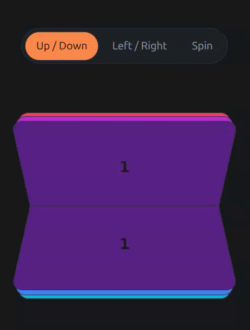

# ChromaClack

ChromaClack is a colour-mixing toy built around one tactile control, a split-flap "clacker". Swipe it to tick it over like a rolodex, or spin it like a dimmer. Each input sets one part of the colour.

## Stack

- SvelteKit and TypeScript for the shared frontend (static SPA)
- Tauri v2 for desktop and mobile shells
- Rust for the shared crate and the Vercel serverless API
- pnpm, Turborepo, Cargo, and Vercel for the workspace and deployment paths

## Status

The clacker's motion is settled in a standalone prototype (`prototype/`). Next it becomes an HSL colour toy, then moves into the SvelteKit app for web, desktop and Android.

## Links

- [ChromaClack: the good, the bad and the ugly](https://www.barryodev.io/posts/chroma-clack-the-good-the-bad-and-the-ugly) — retrospective on the project so far
- [Tightening the loop](https://www.barryodev.io/posts/tightening-the-loop) — the second sprint, working with Claude Code and Linear
- [SETUP.md](SETUP.md) — architecture, local development, and deployment
- [GLOSSARY.md](GLOSSARY.md) — names for the clacker's parts and interactions
